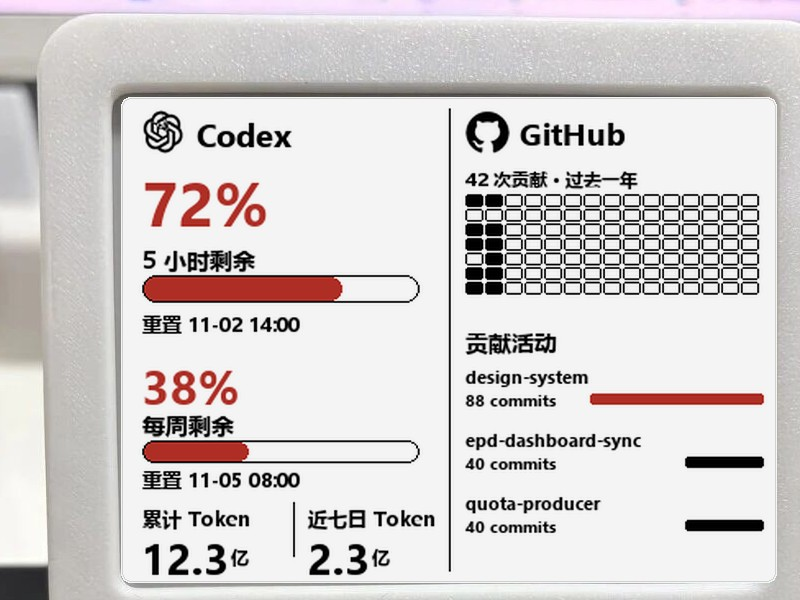
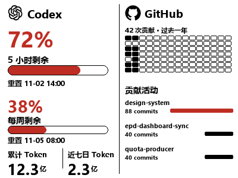
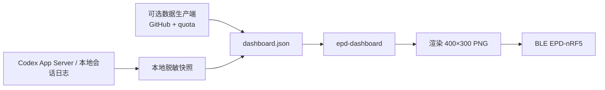

# EPD Dashboard Sync

**把 Codex 额度、Token 用量和 GitHub 动态，放到一块随手可见的电子墨水屏上。**

A Python BLE client that renders a sanitized Codex/GitHub dashboard onto
EPD-nRF5 e-paper displays. It is not a firmware package or a hosted service.



> 实际设备实拍：4.2 英寸 400×300 三色 EPD，驱动 `03`，运行 v2 槽位协议。
> 为保护个人数据，屏幕中的额度、Token、仓库名和贡献数据已做马赛克处理；
> 完整版式见下方示例渲染。



> 上图由 `examples/dashboard.example.json` 生成，用于展示实际渲染版式；
> 示例中的仓库和数值均为虚构数据。

## 这个项目解决什么问题

桌面上同时开着 Codex、GitHub 和一堆仓库时，额度还剩多少、这一周用了多少
Token、最近哪些项目在提交，往往要切好几个页面才能看到。这个项目把这些信息
做成一张 400×300 的三色图片，写到附近的电子墨水屏上：

- 左侧显示 Codex 5 小时/每周剩余额度、重置时间和累计/近七日 Token；
- 右侧显示 GitHub 过去一年贡献热力图、贡献总数和最近活跃仓库；
- 客户端只在同步时短暂连接 BLE，不需要常亮的 BLE 网关；
- 设备只收到渲染后的图片，不会接触 Codex 登录凭据或 GitHub Token。

适合想给桌面加一块低干扰状态屏、又愿意自己准备固件和数据源的人。它不是
“买来即用”的成品，也不包含刷机包。

## 功能

| 能力 | 说明 |
| --- | --- |
| Codex 额度 | 5 小时与每周窗口，支持剩余百分比和重置时间 |
| Codex Token | 账户累计与近七日 Token，缺失时显示 `--`，不根据百分比反推 |
| GitHub 看板 | 贡献热力图、贡献总数、最近三个仓库的提交量 |
| 两种布局 | 独立 Codex/GitHub 槽位，或合成到 Codex 槽位 |
| BLE 写入 | 扫描、连接、分块传输、`ready=1` 确认、断开 |
| 安全边界 | 槽位白名单、保护槽位、哈希去重、过期数据拒绝写入 |
| 跨平台 | macOS LaunchAgent、Windows 任务计划程序 |
| 可选时钟屏 | 可选的 DA14585 2.13 英寸时钟面板同步 |

## 工作方式



本仓库包含客户端、渲染器和本机 Codex 采集器。GitHub 仓库数据与可选的远程
quota 生产端不在本仓库中；你可以自己写一个 producer，只要输出下面约定的
脱敏 JSON 即可。NAS/可信工作机的推荐拓扑和安全边界见
[NAS 采集端方案](docs/nas-producer.md)。

## 支持的设备

代码中包含以下 profile：

| 驱动 | 屏幕 | 颜色 | 验证状态 |
| --- | --- | --- | --- |
| `03` | 4.2 英寸 400×300 | 三色 | 已在真实设备上完成端到端验证 |
| `05` | 4.2 英寸 400×300 | 四色 | 代码支持，需按实际面板验证 |
| `13` | 3.98 英寸 768×552 | 四色 | 代码支持，需按实际面板验证 |

默认 BLE 服务 UUID 为 `62750001-d828-918d-fb46-b6c11c675aec`。设备需要运行
支持槽位协议的 EPD-nRF5 固件，并能响应 `ready=1` 确认。固件、刷机工具和
硬件不包含在本仓库中；上游项目可参考
[tsl0922/EPD-nRF5](https://github.com/tsl0922/EPD-nRF5)。

## 快速开始

### 1. 安装

macOS / Linux：

```bash
git clone <repository-url>
cd epd-dashboard-sync
python3 -m venv .venv
.venv/bin/python -m pip install -e '.[test,ble]'
cp config.example.toml config.toml
```

Windows PowerShell：

```powershell
git clone <repository-url>
cd epd-dashboard-sync
py -3.11 -m venv .venv
.\.venv\Scripts\python.exe -m pip install -e ".[test,ble]"
Copy-Item config.example.toml config.toml
```

### 2. 先不接设备，渲染一张示例图

```bash
.venv/bin/epd-dashboard render \
  --feed examples/dashboard.example.json \
  --output rendered \
  --profile 4.2_400_300_three_color
```

Windows 使用 `.\.venv\Scripts\epd-dashboard.exe`。打开
`rendered/codex.png` 和 `rendered/github.png`，确认字体、数字和热力图正常。
示例数据只用于渲染；`sync-once` 默认会拒绝过期一天的 feed，请换成你自己的
producer 输出。

### 3. 发现设备

保持 `config.toml` 中 `slots.configured = false`，先做只读发现：

```bash
epd-dashboard discover --config config.toml
```

确认输出中的驱动、分辨率、颜色模式、协议版本和槽位数量。然后把实际设备标识
写入 `device.identifier`，把两个明确授权的槽位写入 `slots.codex` 和
`slots.github`，把其他不希望被覆盖的槽位写入 `slots.protected`，最后设置
`slots.configured = true`。

### 4. 手动同步一次

合成看板写入 Codex 槽位：

```bash
epd-dashboard sync-once --config config.toml --only codex --combined
```

或写入两个独立槽位：

```bash
epd-dashboard sync-once --config config.toml
```

`activate_after_sync = true` 时，Codex 槽位使用“保存并刷新”，新图会立即显示；
设为 `false` 则保留设备当前轮播选择。

### 5. 自动同步

macOS：

```bash
epd-dashboard install-autosync \
  --config config.toml \
  --executable .venv/bin/epd-dashboard
```

Windows：

```powershell
.\scripts\windows-sync.ps1 -RepoRoot $PWD
.\scripts\install-windows-task.ps1 -RepoRoot $PWD
```

详细步骤、故障排查和安全检查见 [教程](docs/tutorial.md)。
整体模块边界、数据流和信任边界见 [架构说明](docs/architecture.md)。

## 配置

`config.example.toml` 是完整模板。最常用的字段：

| 字段 | 作用 |
| --- | --- |
| `feed_path` | 脱敏 `dashboard.json` 的路径，可以是本地文件或只读共享 |
| `codex_home` | Codex 本地目录，默认 `~/.codex`，只读 |
| `local_snapshot_output` | 本机脱敏快照输出路径 |
| `local_stale_after_seconds` | 本机快照/额度窗口的新鲜度上限 |
| `device.identifier` | `discover` 后确认的设备标识 |
| `device.service_uuid` | 固件 BLE 服务 UUID |
| `slots.codex` / `slots.github` | 明确授权的零基槽位索引 |
| `slots.protected` | 永远不写入的槽位 |
| `slots.configured` | 未确认槽位前必须保持 `false` |
| `activate_after_sync` | 写入后是否立即激活 Codex 槽位 |
| `clock.enabled` | 是否同步可选的时钟屏 |

不要把密码、Token、Cookie、`auth.json` 或完整 `.env` 写进 `config.toml`。

## 数据契约

客户端只接受经过校验的脱敏 JSON。最小结构如下，完整示例见
[examples/dashboard.example.json](examples/dashboard.example.json)：

```json
{
  "schemaVersion": 1,
  "generatedAt": "2026-11-02T09:00:00+08:00",
  "quota": {
    "fiveHour": { "remainingPercent": 72, "resetsAt": "2026-11-02T14:00:00+08:00" },
    "weekly": { "remainingPercent": 38, "resetsAt": "2026-11-05T08:00:00+08:00" }
  },
  "codex": {
    "tokenUsage": {
      "available": true,
      "total": 1234000000,
      "last7Days": 234000000,
      "observedAt": "2026-11-02T08:55:00+08:00",
      "source": "local-session-log"
    }
  },
  "github": {
    "contributionStatus": "ok",
    "contributions": {
      "totalContributions": 42,
      "lastYear": [{ "date": "2026-11-02", "count": 3 }]
    }
  },
  "repositories": []
}
```

数据不可用时必须显式标记，不能用 0 或估算值伪装成真实数据。客户端会对过期
feed、缺失 Token 和降级 GitHub 数据做拒绝写入保护。

## 安全与隐私

- 设备只接收渲染后的 PNG，不接触任何登录凭据；
- 本机 Codex 采集器只读取用量计数和限额元数据，不读取 `auth.json`、提示词或回复正文；
- GitHub Token 应只存在于数据生产端，并使用最小权限的 fine-grained PAT；
- `feed_path` 应尽量使用只读共享；
- 不要把 `state/`、`logs/`、完整 feed、认证头或原始 API 响应提交到 Git；
- 发现敏感信息时请按 [SECURITY.md](SECURITY.md) 私下报告。
- 公开仓库不包含维护者的真实邮箱、住址、账号名、个人目录、设备地址或私有仓库名；
- 示例配置、示例 feed 和截图中的数值均为占位值或虚构数据。

## 开发与测试

```bash
.venv/bin/python -m pytest -q
git diff --check
```

Windows：

```powershell
.\.venv\Scripts\python.exe -m pytest -q
git diff --check
```

当前公开快照为 `96 passed`，保留 1 个 Pillow 弃用警告。测试使用 fake
transport，不会连接真实设备。

## 已知限制

- 不是通用固件或即插即用产品，必须自行准备兼容设备、固件和 feed；
- GitHub 数据需要单独的 producer；本仓库不包含 GitHub API 采集；
- 私有贡献是否可见取决于 GitHub 账号设置和 Token 权限；
- 设备必须在蓝牙范围内，电脑休眠或蓝牙关闭时不会同步；
- Windows 隐藏 VBS 启动器可能不把 PowerShell 退出码传回任务计划程序，
  排障请查看 `state/windows-sync.log`；
- Codex App Server 协议可能变化，升级 Codex 后建议先跑 `codex-snapshot` 和测试；
- 3.98 英寸四色 profile 尚未逐项做真实设备视觉验收。

## 目录

```text
src/epd_dashboard_sync/   客户端、渲染器、BLE、feed 校验
scripts/                  Windows 同步与计划任务
docs/                     安装、教程、排障和安全说明
examples/                 脱敏示例 feed
tests/                    单元测试与 fake transport
```

## License

代码使用 [MIT License](LICENSE)。设备实拍由项目维护者提供，仅用于本项目展示；
照片中的第三方商标归其各自权利人所有。
