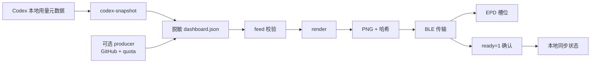

# 架构说明

本文只描述公开仓库中的客户端设计。GitHub/NAS 数据生产端、固件和刷机工具不在
本仓库范围内。

## 设计目标

- 把 Codex 额度、Token 用量和 GitHub 活动压缩成一张 400×300 的三色图片；
- 同步过程短、可重复，失败时不破坏设备上已有的图片；
- 凭据留在数据生产端，设备只接收渲染后的 PNG；
- 没有常驻网络服务，也没有常亮 BLE 网关。

## 组件边界

| 组件 | 职责 | 不负责 |
| --- | --- | --- |
| `cli` | 解析命令、加载配置、串联一次同步 | 保存凭据 |
| `config` | 校验路径、设备标识、槽位和白名单 | 读取 Token |
| `feed` | 校验脱敏 JSON、时间新鲜度和数据可用性 | 访问 GitHub API |
| `codex_local` | 只读本机 Codex 用量元数据 | 读取提示词、回复或 `auth.json` |
| `render` | 生成 Codex、GitHub 或合成看板 PNG | 决定写入哪个槽位 |
| `device` | 发现 profile、读取槽位清单 | 修改设备固件 |
| `sync` | 去重、写入、确认 `ready=1`、记录状态 | 猜测未知槽位 |
| `transport` | BLE 扫描、连接和分块传输 | 解析业务数据 |
| `launchagent` / Windows scripts | 定时触发一次同步 | 保存业务凭据 |

## 数据流

## 信任边界

1. **生产端**：可以接触 GitHub Token、NAS 凭据和原始 API 响应，但这些内容
   不得进入 `dashboard.json`。
2. **客户端**：只读取脱敏 feed 和本机 Codex 用量元数据，输出 PNG。
3. **设备**：只接收图片和协议命令，不接触账号、Token 或文件系统。

客户端不监听网络端口。若你在生产端增加 HTTP 数据源，应自行负责 TLS、认证、
限流、日志脱敏和来源限制，见
[外网访问与安全边界](external-access-threat-model.md)。

## 数据契约

feed 使用 `schemaVersion = 1`，核心字段包括：

- `quota.fiveHour` / `quota.weekly`：剩余百分比和重置时间；
- `codex.tokenUsage`：累计、近七日、观测时间和来源；
- `github.contributions`：过去一年贡献数据；
- `repositories`：最多 5 个仓库的摘要；
- `dataWarnings`：显式降级标记。

数据不可用时必须显式标记，不能用 0 或估算值伪装成真实数据。客户端会拒绝过期
feed、异常时间戳和不完整的设备槽位配置。

## 槽位安全

- 槽位索引从 0 开始；
- `slots.codex` 和 `slots.github` 必须是明确授权的不同槽位；
- `slots.protected` 中的槽位永远不会被写入；
- `slots.configured = false` 时只允许只读发现；
- 写入后等待 `ready=1`，没有确认就不视为成功；
- 内容哈希未变化时跳过重复写入。

## 扩展方式

新增数据源时，优先实现一个输出 `dashboard.json` 的 producer，而不是把凭据和
API 调用塞进客户端。新增屏幕时，先在 `profiles` 中补充经过真实设备验证的
profile，再扩展发现和渲染测试。
