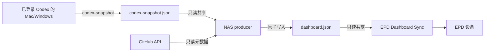

# NAS 采集端方案

本文给出一个可自行实现的 NAS 数据生产端方案。公开仓库本身不包含 NAS、
n8n、通知服务或现成的 producer 代码；这里描述的是推荐拓扑、数据契约和安全边界，
便于你在自己的 NAS 上实现，而不需要把真实地址或凭据写进仓库。

## 推荐拓扑

最稳妥的方式是让一台已登录 Codex 的可信工作机生成脱敏快照，NAS 只负责读取快照、
补全 GitHub 数据并发布 `dashboard.json`。这样 NAS 不需要保存 Codex 登录缓存，
也不会因为反复刷新登录而触发风控。



## 方案 A：可信工作机快照优先

这是推荐方案，适合 Mac、Windows 或一台长期在线的工作机。

1. 在已登录 Codex 的工作机上准备客户端配置，并运行一次只读采集：

   ```bash
   epd-dashboard codex-snapshot --config config.toml
   ```

2. 采集器从本机 Codex App Server 读取 `account/usage/read` 和
   `account/rateLimits/read`，只写出累计 Token、当前活动周 Token、5 小时/每周窗口
   和时间戳，不复制 `auth.json`、原始 JSON-RPC 响应或提示词。

3. 把输出文件放到 NAS 的专用共享目录。路径按你的环境替换：

   - Windows：`\\<NAS_HOST>\<SHARE_NAME>\codex-snapshot.json`
   - macOS：`/Volumes/<NAS_MOUNT>/codex-snapshot.json`
   - NAS 容器：`/data/shared/codex-snapshot.json`

4. producer 读取这份快照，校验 `observedAt`、`available`、窗口长度和来源；快照过期时
   标记 `stale_local_snapshot`，不要把它伪装成实时数据。

5. 工作机定时任务建议只做两件事：生成快照、原子替换共享目录中的文件。不要把
   NAS 的登录密码写进脚本或计划任务参数，使用系统凭据管理器或只读挂载。

## 方案 B：NAS 容器直接读取 App Server

只有在你明确接受风险和运维成本时才使用。它需要 NAS 上有可用的 Codex App Server
登录态或 device-auth 流程；登录缓存必须放在独立数据目录，不能打进镜像或提交到 Git。

建议默认关闭主动刷新：

```dotenv
CODEX_LIVE_REFRESH=false
```

只有共享快照过期且你明确需要时，才低频调用 App Server 刷新。遇到 401、403、429
应退避并保留上一份有效快照，不要自动启动登录流程，也不要在日志里打印认证响应。

## 生产端职责

一个最小 producer 只需要四个职责：

| 职责 | 说明 |
| --- | --- |
| 读取 Codex 快照 | 优先读取可信工作机生成的脱敏快照 |
| 读取 GitHub 元数据 | 仓库摘要、提交数、贡献热力图；Token 只放生产端 |
| 生成看板 JSON | 统一输出 `schemaVersion: 1` 的 `dashboard.json` |
| 原子发布 | 先写临时文件，再替换目标文件，失败时保留上一份有效数据 |

通知（例如 n8n、Bark 或其他推送服务）是可选功能，不属于 EPD 客户端必需链路；通知
失败不能影响看板发布，通知内容也不应包含 Token、Cookie 或完整 API 响应。

## 数据契约

看板文件必须包含带时区的时间戳，并将不可用数据显式标记。示例值均为虚构数据：

```json
{
  "schemaVersion": 1,
  "generatedAt": "2026-11-02T09:00:00+08:00",
  "quota": {
    "fiveHour": {
      "remainingPercent": 72,
      "resetsAt": "2026-11-02T14:00:00+08:00"
    },
    "weekly": {
      "remainingPercent": 38,
      "resetsAt": "2026-11-05T08:00:00+08:00"
    }
  },
  "codex": {
    "tokenUsage": {
      "available": true,
      "total": 1234000000,
      "last7Days": 234000000,
      "observedAt": "2026-11-02T08:55:00+08:00",
      "source": "local-session-log"
    }
  },
  "github": {
    "contributionStatus": "ok",
    "contributions": {
      "totalContributions": 42,
      "lastYear": [
        { "date": "2026-11-02", "count": 3 }
      ]
    }
  },
  "repositories": [],
  "dataWarnings": []
}
```

约束：

- `available: false` 时不要用 `0` 代替缺失值；
- 不要根据额度百分比反推 Token；
- 时间戳必须能被客户端解析，过期时间由客户端再次校验；
- GitHub 私有贡献不可见时，明确写 `private_unverified` 或降级警告，不要伪装成 0；
- `repositories` 只保留展示所需的摘要，不要写入完整 API 响应；
- `dataWarnings` 用于让客户端和排障者知道当前数据是否降级。

## 环境变量模板

下面是通用模板，尖括号内容必须替换；不要把真实值提交到 Git。

```dotenv
TZ=Asia/Shanghai
CODEX_LOCAL_SNAPSHOT_FILE=/data/shared/codex-snapshot.json
DASHBOARD_EXPORT_FILE=/data/shared/dashboard.json
CODEX_LOCAL_STALE_SECONDS=900
CODEX_LIVE_REFRESH=false

# 最多 5 个 owner/name，或 auto:top3
GITHUB_REPOSITORIES=auto:top3
GITHUB_TOKEN_FILE=/run/secrets/github_token

# 默认不开放入站端口；远端访问必须经过 TLS 和认证反向代理
DASHBOARD_HTTP_ENABLED=false
DASHBOARD_HTTP_HOST=127.0.0.1
DASHBOARD_HTTP_PORT=8787

# 可选通知；不配置时不影响看板发布
NOTIFICATION_MODE=n8n
N8N_WEBHOOK_URL=<N8N_WEBHOOK_URL>
N8N_WEBHOOK_SECRET=<RANDOM_SECRET>
N8N_WEBHOOK_AUTH_HEADER=<AUTH_HEADER_NAME>
```

GitHub Token 建议使用 fine-grained PAT，只授予必要仓库和用户级只读权限。优先使用
Docker secret 文件或宿主机只读 secret，不要把 Token 放进 `dashboard.json`、命令行
参数或日志。

## 最小部署步骤

1. 在 NAS 上创建数据目录和共享目录：

   ```text
   <DATA_DIR>/codex
   <DATA_DIR>/state
   <SHARE_DIR>
   ```

   共享目录只放 `codex-snapshot.json` 和 `dashboard.json`，不要混入原始认证缓存。

2. 把 GitHub Token 写入宿主机权限文件，并只读挂载到容器：

   ```text
   <SECRETS_DIR>/github_token  ->  /run/secrets/github_token
   ```

3. 使用容器运行时保持最小权限：

   - `read_only: true`
   - `cap_drop: ["ALL"]`
   - `no-new-privileges:true`
   - 默认不映射公网端口
   - 只挂载 Codex 数据、状态和共享目录

4. 启动 producer 后检查输出：

   ```bash
   cat /data/shared/dashboard.json
   ```

   重点检查 `generatedAt`、`codex.tokenUsage.observedAt`、`available`、`source` 和
   `dataWarnings`，不要只看文件修改时间。

5. 在客户端侧先渲染，再写设备：

   ```bash
   epd-dashboard render \
     --feed /path/to/dashboard.json \
     --output rendered \
     --profile 4.2_400_300_three_color
   ```

   确认文字、数字和热力图正常后，再执行 `sync-once`。设备写入和 producer 发布是
   两个独立步骤，不能用“文件已更新”替代设备回读验收。

## 失败与新鲜度

- 工作机快照不存在、损坏或过旧：显示不可用或 `stale_local_snapshot`，保留上一份
  有效看板；
- App Server 返回 401/403/429：记录失败类型并退避，不自动登录、不把失败写成 0；
- GitHub API 失败：保留上次有效仓库摘要，并写入降级警告；
- 原子发布失败：不要删除旧 `dashboard.json`；
- 设备未连接：只更新文件，不声称设备已经刷新。

## 安全清单

- 文档、示例和提交中不出现真实 NAS 地址、共享名、账号、邮箱、Token 或 Cookie；
- 共享目录使用最小权限，客户端只读；
- GitHub Token 使用 secret 文件，权限限制到必要仓库；
- 日志不打印认证头、原始响应或完整 feed；
- 不把 NAS 管理页面直接暴露到公网；
- 如需外部访问，使用 TLS、短期认证和来源限制，并单独评审；
- 发布前扫描 Git 历史、图片 EXIF 和示例配置。

## 不在本仓库范围

公开仓库不包含可直接运行的 NAS producer、n8n workflow、Bark 推送实现或特定 NAS
厂商的 Compose 文件。上述方案只定义推荐架构和数据契约；具体实现应使用占位符配置，
并在自己的环境中单独验收。
